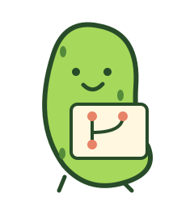

# Working identity

These assets are private development concepts, not cleared public marks.
T033 retains the naming decision. T056 applies the cleared decision to the application and documentation.
Do not publish these assets while naming clearance remains unresolved.

The preserving jar is the primary mark. It uses dill, lime, cream, and mustard.
The branching graph represents retained Git history. Keep the silhouette readable at small sizes.

The Gherkin Guardian mascot supports README illustrations, onboarding, and release announcements.
Use it beside explanatory text. Do not use it as a status or warning indicator.
These vector concepts implement the jar and mascot direction from section 9.3 of the proposal.

Commands remain `protect`, `backup`, `status`, `doctor`, and `restore`.
Keep warnings, missing coverage, approvals, and recovery instructions literal.
Use “In a pickle? Git it back.” only in introductory or campaign material.
Never replace operational terms with jokes or imply recovery of uncaptured data.
